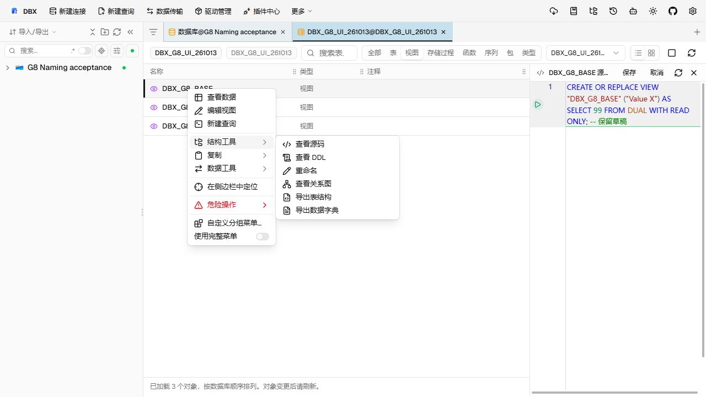
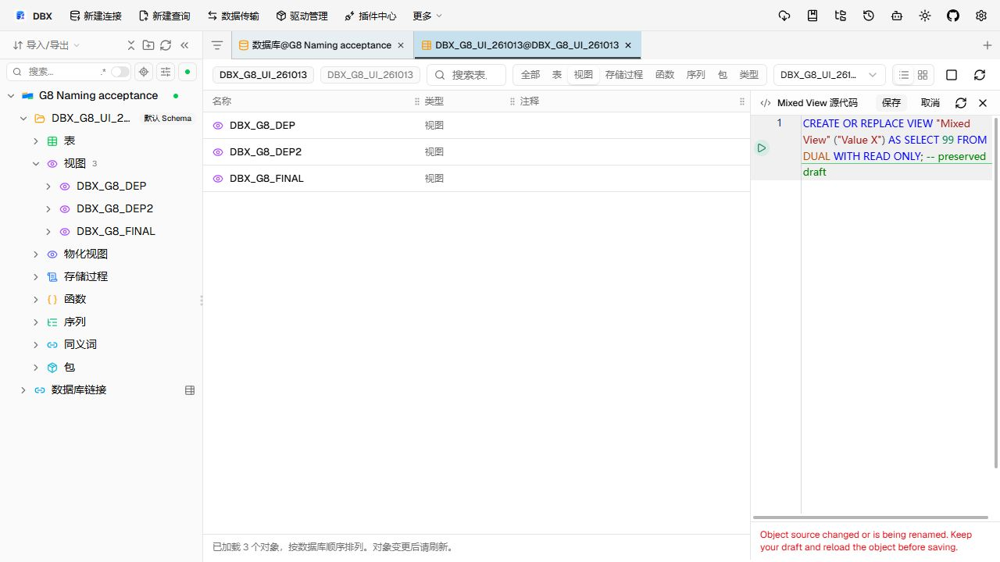

# OceanBase Oracle 普通视图改名验收

本次验收覆盖侧栏和对象浏览器的普通视图改名、同属主静态视图依赖同步，以及打开的源码草稿保护。基线为 `188b94ece23c44a40515915bbf2048cf211a98dd`。数据库为 OceanBase 4.2.5.7 Oracle 模式，产品入口使用 OceanBase Connector/J 2.4.19；验收于 2026-10-13 完成。

## 问题现象

原入口仅开放 OceanBase Oracle 表改名。普通视图可以执行不带属主的 `RENAME`，但直接改名会让原名称引用的依赖视图失效。旧源码编辑上下文还可能按原名称保存，重新创建旧对象。

## 复现与修复验证

操作入口：在侧栏或对象浏览器的普通视图上右键，选择「结构工具 → 重命名」。侧栏选中视图后也可按 F2。填写新名，核对依赖 SQL 预览后确认。

在隔离属主下创建根视图和两级依赖，根视图包含带引号的列别名与 `WITH READ ONLY`，三个视图均授予另一隔离账号 `SELECT WITH GRANT OPTION`。

1. 从侧栏的「结构工具 → 重命名」将根视图改为带空格和混合大小写的引号名称。预览列出根视图 `RENAME`、直接依赖引用改写和间接依赖原定义重建。
2. 从对象浏览器将根视图再次改名，并保留一个未保存的旧名称源码草稿。
3. 通过产品 Agent 读回：旧名称消失，三个视图均为 `VALID`，列别名、只读属性和三项 `SELECT WITH GRANT OPTION` 保留，隔离视图查询结果均为 42。
4. 保存旧草稿被身份检查阻断；草稿内容保留，数据库中的定义及值不变。

生产函数及组件测试覆盖取消、目标切换、依赖图变化、截断元数据、权限降级、两级重建、部分失败、响应未知、并发 hint 修改及迟到源码加载。Rust 改写测试覆盖引号名称、属主、alias、CTE、文本保真，以及当前或后续 CTE 捕获新名称的前置拒绝。

## 执行边界

自动处理范围为当前账号可见、同属主、可安全解析的普通视图依赖。预览明确披露：不可见的跨属主依赖、动态 SQL 和应用引用不会迁移，改名后可能失效。查询成功或零行不证明全库无依赖，也不要求所有用户具有 DBA 权限。

可确认的引用由系统自动改写。某个 hint 或定义无法安全改写时，改名弹框仍保留其余对象的预览，并显示问题对象、hint 原文及可得行列；用户可在同一弹框修正改名前定义并点击“重新校验”。校验会重新检查声明、引用绑定、依赖拓扑和目标身份，通过后才启用原确认按钮。问题未修正时按钮保持禁用，不会派发 DDL。跨属主、非视图、循环或定义/依赖元数据不完整属于当前不可由编辑 SQL 解除的问题，界面会说明原因并要求处理对象或重新读取计划。执行前重新核对目标、定义、依赖及授权；每个依赖覆盖前再比较完整原定义和授权。首错停止并保留原定义和已确认步骤，不执行自动回滚。

源码冻结和保存互斥作用于同一前端实例。其他实例的修改通过元数据复核检测，DDL 执行不具备跨实例原子性。旧只读数据标签保留原名称和结果，需要刷新或重新打开。

## 检查结果与缺口

- 7 个前端测试文件的 53 项测试、类型检查、改动文件格式与 lint 通过；包含中文旧稿保护提示回归。
- Rust 改写 13 项定向测试、SQL Core 全库测试和 Clippy 通过；Web 前后端构建通过。
- 9 个要求的语言包新增键齐备；离线 i18n dry-run 无待补译文件。
- 架构检查在临时将 DuckDB 锁文件换行规范为 LF 后 28 项通过，随后恢复原文件。原 Windows CRLF 工作副本触发既有检查脚本的分隔符解析失败，未计为原命令通过；连接类型生成检查通过。
- 两处 Web GUI 入口和产品 Agent 实库读回通过，隔离对象完成精确清理和读回。
- 原生 Oracle 实库测试获准暂缓；本次结果不能作为原生 Oracle 验收证据。
- Windows 原生桌面构建未执行；Web GUI 不替代原生桌面验收。
- 本文原验收对应的普通视图改名保持上述基线范围。PR50 在 2026-10-14 增加表、例程改名和包另存为修复：Oracle 表列级授权按 `TABLE_SCHEMA` 查询，OceanBase Oracle 保留 `OWNER`；例程和包来源改写失败时保留源草稿并允许重新校验。
- PR50 本轮定向前端测试 7 个文件 96 项通过。SidebarTreeRuntimeHost 组件宿主测试 4 项验证 routine/package 草稿与校验入口透传、原生 Oracle routine prepare 路径、同目标取消后重开保留草稿及目标切换清稿；routine/package 人工修正后重新 prepare 并成功 execute 的 2 项定向测试通过。Rust `oracle_` 测试 103 项通过，包含 strict validator 对 owner/name/type、单 PL/SQL 单元、裸声明和 quoted mixed-case identity 的检查。定向 oxlint 退出码为 0，只有 ObjectBrowser.vue:3387 与 SidebarTreeRuntimeHost.vue:5426 的既有 `no-ex-assign` 告警；`git diff --check` 通过。
- Oracle package 源码写入前通过既有 executable-source builder 校验生成的 spec/body；native Oracle routine caller 草稿在 rename 专用 validator 中校验 owner、name、type 和完整 PL/SQL 边界，并经 Tauri/Web 两条 backend 传输注册。routine rename caller view 在 prepare、替换后读回及删除旧 routine 前复用 Oracle view review API，拒绝声明名不匹配的 `CREATE OR REPLACE VIEW` 草稿；一般 view builder 对裸查询的契约未改。侧栏与 ObjectBrowser 的 routine draft 生命周期及编辑后旧 SQL 隐藏已补修。PR50 两入口 Web GUI 与 OceanBase Oracle 实库验收由主会话继续完成；本轮没有执行 Oracle DDL。原生 Oracle 实库测试继续暂缓，不计为通过。

本批同时补齐基线 HANA `column_data_type` 调用缺失的参数，使当前 Web 构建可执行。docs-export 构建发现基线依赖生成漂移；相关输入没有本次改动，因此保留基线产物，不将无关生成差异带入本批。
